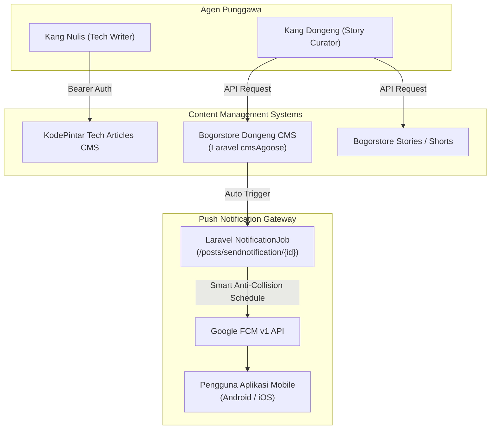

# Integrasi CMS & Push Notification (Bogorstore & KodePintar)

Dokumentasi lengkap mengenai integrasi penerbitan konten ke **Bogorstore CMS (cmsAgoose)**, **KodePintar Tech Articles**, serta sistem **Smart Anti-Collision Push Notification (Google FCM)**.

---

## 📑 Daftar Isi
1. [Arsitektur & Komponen](#1-arsitektur--komponen)
2. [Konfigurasi Environment](#2-konfigurasi-environment)
3. [Bogorstore Dongeng CMS (cmsAgoose)](#3-bogorstore-dongeng-cms-cmsagoose)
   - [Publikasi Cerita Dongeng](#publikasi-cerita-dongeng)
   - [Publikasi Stories / Shorts](#publikasi-stories--shorts)
   - [Deduplikasi Konten](#deduplikasi-konten)
4. [KodePintar Tech Articles CMS](#4-kodepintar-tech-articles-cms)
5. [Smart Anti-Collision Push Notification (Google FCM)](#5-smart-anti-collision-push-notification-google-fcm)
   - [Mekanisme Anti-Bentrok Notifikasi](#mekanisme-anti-bentrok-notifikasi)
   - [Mode Penjadwalan](#mode-penjadwalan)
6. [Skrip Pengujian Notifikasi (`scripts/test_cms_notifier.py`)](#6-skrip-pengujian-notifikasi-scriptstest_cms_notifierpy)

---

## 1. Arsitektur & Komponen

Agen **Kang Nulis** dan **Kang Dongeng** mempublikasikan hasil kurasi dan penulisan AI ke dua sistem CMS:



---

## 2. Konfigurasi Environment

Variabel lingkungan yang mengatur penerbitan CMS di `config/settings.py` / `.env`:

```env
# Bogorstore Dongeng CMS (cmsAgoose)
DONGENG_CMS_POST_URL=https://bogorstore.com/agoose/api/posts
DONGENG_CMS_STORIES_URL=https://bogorstore.com/agoose/api/posts/stories
DONGENG_CMS_SEARCH_URL=https://bogorstore.com/agoose/api/posts/search
DONGENG_CMS_NOTIFICATION_URL=https://bogorstore.com/agoose/posts/sendnotification
DONGENG_CMS_COOKIE=your_optional_session_cookie

# KodePintar Tech Articles CMS (Lucy)
API_ENDPOINT=https://kodepintar.com/api/articles/publish
SECRET_KEY=your_kodepintar_secret_key
USER_ID=author_user_id
```

---

## 3. Bogorstore Dongeng CMS (cmsAgoose)

### Publikasi Cerita Dongeng
Agen **Kang Dongeng** merangkum video YouTube dongeng menjadi naskah cerita terstruktur untuk dibaca anak dan orang tua di aplikasi mobile.

**Struktur Payload Publikasi:**
```json
{
  "title": "Legenda Putri Mandalika dan Asal Usul Bau Nyale",
  "content": "<p>Pada zaman dahulu di Lombok Selatan...</p>",
  "video_id": "dQw4w9WgXcQ",
  "category_id": 3,
  "thumbnail": "https://storage.bogorstore.com/thumbnails/mandalika.jpg",
  "status": "published"
}
```

### Publikasi Stories / Shorts
Untuk klip animasi pendek berdurasi di bawah 60 detik, konten dikirim ke endpoint `DONGENG_CMS_STORIES_URL` agar tampil di carousel instan stories di aplikasi.

### Deduplikasi Konten
Sebelum memproses video baru, agen memanggil `DONGENG_CMS_SEARCH_URL` dengan judul video untuk memastikan cerita tersebut belum pernah dipublikasikan sebelumnya.

---

## 4. KodePintar Tech Articles CMS

Agen **Kang Nulis** menulis artikel panduan teknologi, programming, dan AI secara mendalam melalui pipeline riset multi-sumber (Brave API & Google News).

**Struktur Pemanggilan API:**
- **Metode**: `POST $API_ENDPOINT`
- **Header**: `Authorization: Bearer $SECRET_KEY`
- **Format**: JSON dengan Markdown-rendered HTML, daftar tags, referensi sumber, dan cover image Pexels.

---

## 5. Smart Anti-Collision Push Notification (Google FCM)

Setelah sebuah postingan dongeng diterbitkan ke CMS Bogorstore, sistem secara otomatis memicu push notification ke seluruh pengguna aplikasi Android dan iOS.

### Mekanisme Anti-Bentrok Notifikasi
Jika beberapa artikel dongeng terbit dalam waktu berdekatan, mengirim notifikasi secara bersamaan dapat mengganggu pengguna (*spamming*). Punggawa menerapkan algoritma **Smart Anti-Collision**:
1. Menargetkan **Jam Emas Membaca (17:00:00 WIB)** sebagai waktu default anak-anak bersiap istirahat dan mendengarkan dongeng.
2. Jika slot jam 17:00 telah terisi oleh notifikasi lain, sistem secara otomatis menggeser jadwal ke slot berikutnya:
   - Slot 2: **19:00 WIB** (+2 jam)
   - Slot 3: **21:00 WIB** (waktu pengantar tidur)
   - Slot 4: **12:00 WIB esok hari** jika seluruh slot malam telah penuh.

### Mode Penjadwalan
Fungsi `trigger_post_notification` di `orchestrator/tools/cms_notifier.py` mendukung 4 mode:
- `smart` (Default): Menggunakan algoritma penempatan slot anti-bentrok.
- `instant`: Notifikasi dikirimkan langsung detik itu juga.
- `delay`: Menunda pengiriman selama $N$ menit (misal 30, 60, atau 120 menit).
- `specific`: Menjadwalkan ke jam spesifik tertentu (format `HH:MM`).

---

## 6. Skrip Pengujian Notifikasi (`scripts/test_cms_notifier.py`)

Anda dapat menguji jalur push notification untuk sebuah post ID tertentu:

```bash
# Uji coba mode smart
./venv/bin/python scripts/test_cms_notifier.py --post-id 1450 --mode smart

# Uji coba mode instant
./venv/bin/python scripts/test_cms_notifier.py --post-id 1450 --mode instant
```
