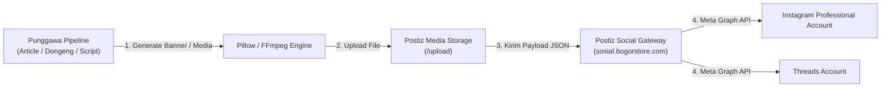

# Integrasi Instagram & Threads (Meta Graph API)

Dokumentasi lengkap mengenai integrasi otomatisasi publikasi konten ke **Instagram** dan **Threads** pada sistem **Punggawa**, menggunakan platform **Postiz Social Gateway** sebagai jembatan ke Meta Graph API.

---

## 📑 Daftar Isi
1. [Arsitektur & Alur Publikasi](#1-arsitektur--alur-publikasi)
2. [Prasyarat Akun & Meta Graph API](#2-prasyarat-akun--meta-graph-api)
3. [Portal Developer, Domain & Pendaftaran Akun Tester (Meta)](#3-portal-developer-domain--pendaftaran-akun-tester-meta)
4. [Mengatasi Error Scopes (`pages_read_engagement`, `instagram_manage_insights`)](#4-mengatasi-error-scopes-pages_read_engagement-instagram_manage_insights)
5. [Panduan Lengkap Menghubungkan Instagram ke Facebook Page](#5-panduan-lengkap-menghubungkan-instagram-ke-facebook-page)
   - [Mengapa Akun Baru Tidak Muncul di Postiz?](#mengapa-akun-baru-tidak-muncul-di-postiz)
   - [Metode 1: Lewat Web Facebook (Linked Accounts - Rekomendasi Utama ⭐)](#metode-1-lewat-web-facebook-linked-accounts---rekomendasi-utama-)
   - [Metode 2: Lewat Meta Business Suite (Instagram Profiles)](#metode-2-lewat-meta-business-suite-instagram-profiles)
   - [Metode 3: Lewat Aplikasi HP (Pusat Akun Meta Terbaru)](#metode-3-lewat-aplikasi-hp-pusat-akun-meta-terbaru)
   - [Langkah Final di Postiz (Simpan Channel & Ambil Integration ID)](#langkah-final-di-postiz-simpan-channel--ambil-integration-id)
6. [Konfigurasi Environment](#6-konfigurasi-environment)
7. [Format Media & Spesifikasi Teknis](#7-format-media--spesifikasi-teknis)
8. [Alur Pemanggilan API Postiz](#8-alur-pemanggilan-api-postiz)
9. [Skrip Pengujian Otomatis (`scripts/test_postiz_autopost.py`)](#9-skrip-pengujian-otomatis-scriptstest_postiz_autopostpy)
10. [Integrasi Khusus Threads](#10-integrasi-khusus-threads)
11. [Troubleshooting & Solusi Error](#11-troubleshooting--solusi-error)

---

## 1. Arsitektur & Alur Publikasi

Sistem Punggawa memanfaatkan arsitektur terpusat melalui Postiz untuk mengelola token autentikasi Meta yang kompleks.



---

## 2. Prasyarat Akun & Meta Graph API

Meta Graph API memiliki kebijakan ketat mengenai jenis akun yang dapat menerima postingan otomatis dari pihak ketiga:

1. **Wajib Akun Profesional (Professional Account)**:
   - Akun Instagram pribadi (*Personal*) **tidak didukung** oleh Meta Graph API untuk posting otomatis.
   - Akun harus dikonversi menjadi tipe **Creator** atau **Business**.
2. **Koneksi ke Facebook Page**:
   - Akun Instagram Profesional harus ditautkan ke sebuah **Halaman Facebook (Facebook Page)** aktif yang Anda kelola.
3. **Permissions yang Diperlukan di Meta App**:
   - `instagram_basic`: Membaca profil dan media akun Instagram.
   - `instagram_content_publish`: Izin inti untuk memposting feed dan reels.
   - `pages_show_list`: Mengambil daftar Halaman Facebook yang dikelola.
   - `pages_read_engagement`: Membaca data keterlibatan Halaman Facebook.
   - `instagram_manage_insights`: Membaca metrik performa postingan dan cerita.
   - `business_management`: Mengelola aset bisnis yang terhubung.

---

## 3. Portal Developer, Domain & Pendaftaran Akun Tester (Meta)

Saat aplikasi Meta masih dalam tahap pengembangan (**In Development Mode**), Meta memblokir akun publik dan hanya mengizinkan akun yang telah terdaftar sebagai **Tester** atau **Developer**.

### 🌐 Daftar Domain & URL Kunci
- **Portal Meta for Developers**: [https://developers.facebook.com/](https://developers.facebook.com/)
- **Halaman Konfirmasi Tester (Wajib Diakses Tester)**: [https://www.instagram.com/accounts/manage_access/](https://www.instagram.com/accounts/manage_access/)
- **Domain Redirect URI (OAuth Callback)**: `https://sosial.bogorstore.com/api/auth/callback/instagram` (atau `https://sosial.bogorstore.com/api/auth/callback/threads`)

---

### 🛠️ Langkah-Langkah Mendaftarkan Akun Tester Instagram:

1. **Masuk ke Portal Meta Developer**:
   - Kunjungi [https://developers.facebook.com/](https://developers.facebook.com/) dan login menggunakan akun Facebook admin Anda.
   - Klik menu **My Apps** di kanan atas, lalu pilih aplikasi yang terhubung ke Postiz (misalnya `Bogorstore Social` - App ID `1442069561325234`).

2. **Buka Menu Roles (Peran)**:
   - Pada panel navigasi di sebelah kiri, klik **App Roles** (atau **Roles** / **Peran**).
   - Pilih submenu **Roles**.

3. **Undang Akun Instagram sebagai Tester**:
   - Gulir ke bawah hingga menemukan bagian **Instagram Testers** (atau klik tab **Testers**).
   - Klik tombol **Add Instagram Testers** (atau *Tambahkan Penguji Instagram*).
   - Masukkan **Username Instagram** dari akun yang ingin didaftarkan (misal: `kittengaul`, `reggimuhamad`, dll).
   - Klik **Submit**. Status akun akan menjadi *Pending* (Menunggu Konfirmasi).

4. **Konfirmasi Undangan di Web Instagram (Langkah Wajib!)**:
   - Buka browser dan login ke akun Instagram yang baru saja diundang di:
     👉 [https://www.instagram.com/accounts/manage_access/](https://www.instagram.com/accounts/manage_access/)
   - Klik tab **Tester Invitations (Undangan Penguji)**.
   - Akan muncul kartu undangan dari nama aplikasi Meta Anda. Klik tombol **Accept (Terima)**.
   - Di dashboard Meta Developer, status akun akan langsung berubah dari *Pending* menjadi tester aktif.

---

## 4. Mengatasi Error Scopes (`pages_read_engagement`, `instagram_manage_insights`)

Jika saat login muncul pesan error:
```text
Invalid Scopes: pages_read_engagement, instagram_manage_insights.
This message is only shown to developers. Users of your app will ignore these permissions if present.
```

### Penyebab:
Postiz meminta izin (*scopes*) `pages_read_engagement` dan `instagram_manage_insights` saat proses otorisasi OAuth. Jika kedua izin ini belum diaktifkan di dashboard aplikasi Meta Developer Anda, Meta akan menolak request login tersebut.

### Solusi di Meta for Developers:
1. Buka [https://developers.facebook.com/apps/](https://developers.facebook.com/apps/) dan pilih aplikasi Anda.
2. Di panel navigasi kiri, klik **Use cases**.
3. Cari use case **Manage messaging & content on Instagram** ➔ klik tombol **Customize**.
4. Klik tab **Permissions and features**.
5. Temukan permission:
   - `instagram_manage_insights` ➔ klik tombol **Add**.
   - `pages_read_engagement` ➔ klik tombol **Add**.
6. Status kedua permission akan berubah menjadi **Ready for testing**.
7. Coba hubungkan ulang di Postiz, error *Invalid Scopes* akan hilang seketika.

---

## 5. Panduan Lengkap Menghubungkan Instagram ke Facebook Page

### Mengapa Akun Baru Tidak Muncul di Postiz?
Meskipun akun Instagram baru (misalnya `@kittengaul`) **sudah berhasil berstatus Tester** di Meta Developer Portal, akun tersebut **tetap tidak akan muncul di daftar pilihan "Select Instagram Account" Postiz jika belum terhubung ke sebuah Facebook Page**.

Postiz menggunakan endpoint Meta Graph API `/me/accounts`. Saat Anda login dengan Facebook, Meta hanya mengembalikan akun Instagram yang **sudah ditautkan ke salah satu Halaman Facebook (Facebook Page) yang Anda kelola**.

---

### Metode 1: Lewat Web Facebook (Linked Accounts - Rekomendasi Utama ⭐)

Cara ini paling stabil dan langsung terverifikasi oleh server Facebook:

1. **Buka Web Facebook di Browser:**
   - Kunjungi halaman pengelola Facebook Pages:
     👉 [https://www.facebook.com/pages/](https://www.facebook.com/pages/)
2. **Pilih atau Buat Halaman Baru:**
   - Pilih Halaman Facebook yang sudah ada milik Anda, **atau**
   - Klik **+ Buat Halaman Baru (Create new Page)** di bilah kiri. Beri nama bebas (misal: *Kitten Gaul Official* atau *Kedai Daily*) ➔ klik **Buat Halaman**.
3. **Buka Pengaturan Akun Tertaut (Linked Accounts):**
   - Beralih ke profil Halaman Facebook tersebut.
   - Di bilah menu sebelah kiri, klik **Pengaturan (Settings)**.
   - Pilih menu **Akun Tertaut (Linked Accounts)**.
   - Klik menu **Instagram**.
4. **Hubungkan Akun Instagram:**
   - Klik tombol biru **Hubungkan Akun (Connect Account)**.
   - Akan muncul konfirmasi sinkronisasi pesan & insight ➔ klik **Hubungkan (Connect)** ➔ klik **Konfirmasi (Confirm)**.
   - Pop-up jendela login Instagram resmi akan terbuka:
     - Masukkan username akun Instagram baru Anda (misal: `kittengaul`).
     - Masukkan password akun Instagram Anda ➔ klik **Masuk (Log In)**.
     - Jika ada permintaan verifikasi OTP / SMS, selesaikan verifikasi.
5. **Verifikasi Status:**
   - Halaman pengaturan akan menampilkan tanda centang hijau: *"Akun Instagram Anda terhubung"*.

---

### Metode 2: Lewat Meta Business Suite (Instagram Profiles)

Jika akun Anda menggunakan Business Portfolio Meta (misalnya `bogorstore.com`):

1. **Buka Halaman Pengaturan Instagram di Meta Business Suite:**
   - Kunjungi link langsung berikut:
     👉 [https://business.facebook.com/latest/settings/instagram_account?business_id=203592303674436](https://business.facebook.com/latest/settings/instagram_account?business_id=203592303674436)
2. **Buka Form Tambah Akun:**
   - Pada panel *Instagram profiles*, klik tombol **Add (Tambahkan)** di pojok kanan atau tengah halaman.
   - Di jendela dialog yang muncul (*Add an Instagram profile*), klik tombol biru **Add Instagram profile**.
3. **Login & Otorisasi Akun:**
   - Jendela login Instagram akan terbuka.
   - Masukkan username akun Instagram (misal: `kittengaul`) dan password.
   - Jika akun masih berstatus akun personal, Meta akan secara otomatis menawarkan pengubahan ke akun profesional ➔ setujui.
4. Akun Instagram kini resmi terdaftar di dalam portofolio bisnis dan terhubung ke ekosistem Facebook Anda.

---

### Metode 3: Lewat Aplikasi HP (Pusat Akun Meta Terbaru)

> [!NOTE]
> Pada pembaruan antarmuka Instagram terbaru, opsi "Halaman" di tombol *Edit Profil* telah dipindahkan ke **Pusat Akun (Meta Accounts Center)**.

1. Buka aplikasi **Instagram** di smartphone pada akun baru (`kittengaul`).
2. Masuk ke halaman **Profil** ➔ tap ikon menu garis tiga (☰) di pojok kanan atas.
3. Tap menu **Pusat Akun (Accounts Center)** yang berada di bagian paling atas.
4. Gulir ke bagian *Pengaturan Akun (Account settings)* ➔ tap **Pengalaman terhubung (Connected experiences)**.
5. Tap **Berbagi antar-profil (Sharing across profiles)**.
6. Tap **Tambah Akun (Add accounts)** ➔ pilih **Tambah akun Facebook**.
7. Login menggunakan akun Facebook Anda (`Regi`) dan pilih Halaman Facebook yang ingin dipasangkan.

---

### Langkah Final di Postiz (Simpan Channel & Ambil Integration ID)

Setelah akun Instagram berhasil ditautkan ke Facebook Page melalui salah satu metode di atas:

1. Buka dashboard Postiz di:
   👉 [https://sosial.bogorstore.com/launches](https://sosial.bogorstore.com/launches)
2. Klik tombol **Add Channel** di bilah kiri.
3. Pilih opsi **Instagram (Facebook Business)**.
4. Selesaikan pop-up Facebook Login (jika diminta, pastikan mencentang Halaman Facebook dan Akun Instagram baru Anda).
5. Pada layar dialog **Configure Your Channel**:
   - Sekarang kartu profil akun baru Anda (misal: **`kittengaul`**) sudah **resmi muncul** berdampingan dengan *Regi* dan *Master Laptop*!
6. Klik kartu profil akun tersebut hingga berbingkai ungu/aktif, lalu klik tombol **Save**.
7. Buka menu **Settings** ➔ **Integrations** (atau panggil API `GET /api/public/v1/integrations`) untuk menyalin **Integration ID** baru tersebut ke `.env` sistem Punggawa:
   ```env
   POSTIZ_INSTAGRAM_INTEGRATION_ID=cmvvzqhn7000epl6yd8bp7mzz # Ganti dengan ID baru
   ```

---

## 6. Konfigurasi Environment

Nilai integrasi disimpan di file `.env` atau `config/settings.py`:

```env
# Postiz Gateway
POSTIZ_API_KEY=your_postiz_api_key_here
POSTIZ_BASE_URL=https://sosial.bogorstore.com/api/public/v1

# Meta Platform Integration IDs
POSTIZ_INSTAGRAM_INTEGRATION_ID=cmvvzqhn7000epl6yd8bp7mzz  # Akun Instagram
POSTIZ_THREADS_INTEGRATION_ID=cmw1m3jvh0001o274j5o6snns    # Akun Threads
```

---

## 7. Format Media & Spesifikasi Teknis

### A. Postingan Feed (Gambar)
Meta Graph API mewajibkan rasio aspek tertentu untuk postingan gambar:

| Rasio Aspek | Resolusi Standar | Keterangan |
|---|---|---|
| **Square (1:1)** | 1080 x 1080 px | Format paling aman, digunakan pada banner otomatis Punggawa. |
| **Portrait (4:5)** | 1080 x 1350 px | Memberikan area visual vertikal maksimal di feed pengguna. |
| **Landscape (1.91:1)**| 1080 x 566 px | Format horizontal lebar. |

- **Format File**: JPEG (`image/jpeg`) atau PNG (`image/png`).
- **Ukuran Maksimal**: 8 MB.

### B. Instagram Reels (Video)
- **Rasio Aspek**: 9:16 Portrait (1080 x 1920 px).
- **Durasi**: 3 detik hingga 90 detik.
- **Video Codec**: H.264 / MP4.
- **Audio Codec**: AAC, 128 kbps.

---

## 8. Alur Pemanggilan API Postiz

### Langkah 1: Unggah Gambar ke Media Storage
```bash
curl -X POST "https://sosial.bogorstore.com/api/public/v1/upload" \
  -H "Authorization: $POSTIZ_API_KEY" \
  -F "file=@banner_artikel.jpg;type=image/jpeg"
```
**Respons Sukses (HTTP 201):**
```json
{
  "id": "cmw_media_uuid_12345",
  "path": "https://storage.bogorstore.com/uploads/banner_artikel.jpg"
}
```

### Langkah 2: Dispatch Postingan Feed
```json
POST https://sosial.bogorstore.com/api/public/v1/posts
Header: Authorization: $POSTIZ_API_KEY
Content-Type: application/json

{
  "type": "now",
  "date": "2026-11-09T10:00:00.000Z",
  "shortLink": false,
  "tags": [],
  "posts": [
    {
      "integration": {
        "id": "cmvvzqhn7000epl6yd8bp7mzz"
      },
      "value": [
        {
          "content": "Halo dari Punggawa Orchestrator! 🚀\n\nArtikel teknologi terbaru kini telah terbit.\n\n#tech #automation #ai #punggawa",
          "image": [
            {
              "id": "cmw_media_uuid_12345",
              "path": "https://storage.bogorstore.com/uploads/banner_artikel.jpg"
            }
          ]
        }
      ],
      "settings": {
        "__type": "instagram",
        "post_type": "post"
      }
    }
  ]
}
```

---

## 9. Skrip Pengujian Otomatis (`scripts/test_postiz_autopost.py`)

Punggawa menyertakan skrip otomatisasi end-to-end untuk menguji jalur integrasi Instagram:

### Fitur Skrip:
1. **Generasi Grafis Dinamis**: Menggunakan pustaka Python Pillow (`PIL`) untuk membuat gambar banner resolusi tinggi (1080x1080 px) bertema dark cybernetic lengkap dengan timestamp real-time, badge checklist fitur, dan watermark verifikasi.
2. **Buffer Memory-Direct**: File disimpan ke dalam buffer biner RAM (`io.BytesIO`) tanpa mengotori disk lokal.
3. **Penerbitan Otomatis**: Mengirimkan banner dan caption langsung ke Meta Graph API melalui Postiz.

### Menjalankan Skrip:
```bash
./venv/bin/python scripts/test_postiz_autopost.py
```

**Output Log Terminal:**
```text
🚀 [Punggawa] Starting Postiz Instagram Autopost Test...
✅ Generated 1080x1080 banner with timestamp: 09 November 2026 - 10:45:00 WIB
✅ Uploaded to Postiz Storage: https://.../punggawa_test.jpg
✅ Post enqueued successfully in Postiz! Details: [{'postId': 'post_991823'}]

⏳ Worker is publishing to Meta Graph API...
```

---

## 10. Integrasi Khusus Threads

Punggawa juga mendukung penerbitan otomatis ke platform **Threads** menggunakan integrasi `POSTIZ_THREADS_INTEGRATION_ID`:

### Karakteristik Payload Threads:
- **Teks**: Mendukung hingga 500 karakter per postingan.
- **Media**: Mendukung lampiran gambar (JPEG/PNG) dan video pendek (MP4).
- **Settings**:
  ```json
  "settings": {
    "__type": "threads"
  }
  ```

---

## 11. Troubleshooting & Solusi Error

| Gejala Error | Penyebab Utama | Solusi |
|---|---|---|
| `Invalid Scopes: pages_read_engagement, instagram_manage_insights` | Izin belum diaktifkan di Use Cases aplikasi Meta Developer. | Buka Meta Developer Portal > Use cases > *Manage messaging & content on Instagram* > *Permissions and features* > Tambahkan `pages_read_engagement` & `instagram_manage_insights`. |
| Akun Tester tidak muncul di Postiz | Akun Instagram belum ditautkan ke Facebook Page yang dikelola Facebook admin. | Hubungkan akun Instagram ke Facebook Page via Web Facebook (menu *Akun Tertaut*) atau Meta Business Suite. |
| `OAuthException: Error validating access token` | Token Facebook/Meta berumur maksimal 60 hari dan telah kedaluwarsa. | Buka dashboard `sosial.bogorstore.com` > menu **Integrations** > klik tombol **Reconnect** pada akun Instagram. |
| `Media ratio not supported` | Rasio gambar di luar batas (misal gambar terlalu panjang vertikal atau terlalu lebar). | Pastikan rasio gambar berada di antara **4:5 (vertikal)** hingga **1.91:1 (horizontal)**, atau gunakan standar 1:1 (1080x1080 px). |
| `User is not a business or creator account` | Akun Instagram masih berstatus akun personal. | Ubah status akun menjadi **Creator** atau **Business** melalui aplikasi Instagram di ponsel. |
| `Page is not linked to Instagram` | Halaman Facebook belum dihubungkan dengan akun Instagram. | Buka Facebook Page Settings > Linked Accounts > Hubungkan akun Instagram target. |
