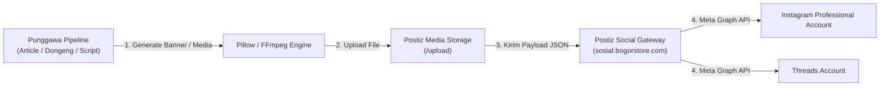

# Integrasi Instagram & Threads (Meta Graph API)

Dokumentasi lengkap mengenai integrasi otomatisasi publikasi konten ke **Instagram** dan **Threads** pada sistem **Punggawa**, menggunakan platform **Postiz Social Gateway** sebagai jembatan ke Meta Graph API.

---

## 📑 Daftar Isi
1. [Arsitektur & Alur Publikasi](#1-arsitektur--alur-publikasi)
2. [Prasyarat Akun & Meta Graph API](#2-prasyarat-akun--meta-graph-api)
3. [Portal Developer, Domain & Pendaftaran Akun Tester (Meta)](#3-portal-developer-domain--pendaftaran-akun-tester-meta)
4. [Konfigurasi Environment](#4-konfigurasi-environment)
5. [Format Media & Spesifikasi Teknis](#5-format-media--spesifikasi-teknis)
6. [Alur Pemanggilan API Postiz](#6-alur-pemanggilan-api-postiz)
7. [Skrip Pengujian Otomatis (`scripts/test_postiz_autopost.py`)](#7-skrip-pengujian-otomatis-scriptstest_postiz_autopostpy)
8. [Integrasi Khusus Threads](#8-integrasi-khusus-threads)
9. [Troubleshooting & Solusi Error](#9-troubleshooting--solusi-error)

---

## 1. Arsitektur & Alur Publikasi

Sistem Punggawa memanfaatkan arsitektur terpusat melalui Postiz untuk mengelola token autentikasi Meta yang kompleks.



---

## 2. Prasyarat Akun & Meta Graph API

Meta Graph API memiliki kebijakan ketat mengenai jenis akun yang dapat menerima postingan otomatis dari pihak ketiga:

1. **Wajib Akun Profesional (Professional Account)**:
   - Akun Instagram pribadi (*Personal*) **tidak didukung** oleh Meta Graph API.
   - Akun harus dikonversi menjadi tipe **Creator** atau **Business** melalui menu *Settings > Account type and tools > Switch to professional account* di aplikasi Instagram.
2. **Koneksi ke Facebook Page**:
   - Akun Instagram Profesional harus ditautkan ke sebuah **Halaman Facebook (Facebook Page)** aktif yang Anda kelola.
3. **Permissions yang Diperlukan di Meta App**:
   - `instagram_basic`: Membaca profil dan metadata akun.
   - `instagram_content_publish`: Izin inti untuk memposting feed dan reels.
   - `pages_show_list`: Menampilkan daftar fanspage yang terhubung.
   - `pages_read_engagement`: Membaca performa dan komentar.

---

## 3. Portal Developer, Domain & Pendaftaran Akun Tester (Meta)

Saat aplikasi Meta masih dalam tahap pengembangan (**In Development Mode**), Meta memblokir akun publik dan hanya mengizinkan akun yang telah terdaftar sebagai **Tester** atau **Developer**.

### 🌐 Daftar Domain & URL Kunci
- **Portal Meta for Developers**: [https://developers.facebook.com/](https://developers.facebook.com/)
- **Halaman Konfirmasi Tester (Wajib Diakses Tester)**: [https://www.instagram.com/accounts/manage_access/](https://www.instagram.com/accounts/manage_access/)
- **Domain Redirect URI (OAuth Callback)**: `https://sosial.bogorstore.com/api/auth/callback/instagram` (atau `https://sosial.bogorstore.com/api/auth/callback/threads`)

---

### 🛠️ Langkah-Langkah Mendaftarkan Akun Tester Instagram:

1. **Masuk ke Portal Meta Developer**:
   - Kunjungi [https://developers.facebook.com/](https://developers.facebook.com/) dan login menggunakan akun Facebook admin Anda.
   - Klik menu **My Apps** di kanan atas, lalu pilih aplikasi yang terhubung ke Postiz.

2. **Buka Menu Roles (Peran)**:
   - Pada panel navigasi di sebelah kiri, klik **App Roles** (atau **Roles** / **Peran**).
   - Pilih submenu **Roles**.

3. **Undang Akun Instagram sebagai Tester**:
   - Gulir ke bawah hingga menemukan bagian **Instagram Testers** (atau bagian **Testers**).
   - Klik tombol **Add Instagram Testers** (atau *Tambahkan Penguji Instagram*).
   - Masukkan **Username Instagram** dari akun yang ingin didaftarkan (misal: `@reggimuhamad` atau `@nurulzulaikhha`).
   - Klik **Submit**. Status akun akan berubah menjadi *Pending* (Menunggu Konfirmasi).

4. **Konfirmasi Undangan di Web Instagram (Langkah Wajib!)**:
   - Buka browser dan login ke akun Instagram yang baru saja diundang di:
     👉 [https://www.instagram.com/accounts/manage_access/](https://www.instagram.com/accounts/manage_access/)
   - Klik tab **Tester Invitations (Undangan Penguji)**.
   - Akan muncul kartu undangan dari nama aplikasi Meta Anda. Klik tombol **Accept (Terima)**.

5. **Hubungkan Ulang di Postiz**:
   - Buka dashboard Postiz di `https://sosial.bogorstore.com/integrations`.
   - Klik **Connect Instagram** (atau *Reconnect*).
   - Login menggunakan akun Instagram yang telah berstatus *Accepted Tester*. Otorisasi OAuth akan berhasil tanpa perlu menunggu aplikasi disetujui secara publik (*App Review*).

---

## 4. Konfigurasi Environment

Nilai integrasi disimpan di file `.env` atau `config/settings.py`:

```env
# Postiz Gateway
POSTIZ_API_KEY=your_postiz_api_key_here
POSTIZ_BASE_URL=https://sosial.bogorstore.com/api/public/v1

# Meta Platform Integration IDs
POSTIZ_INSTAGRAM_INTEGRATION_ID=cmvvzqhn7000epl6yd8bp7mzz  # Akun Instagram
POSTIZ_THREADS_INTEGRATION_ID=cmw1m3jvh0001o274j5o6snns    # Akun Threads
```

---

## 5. Format Media & Spesifikasi Teknis

### A. Postingan Feed (Gambar)
Meta Graph API mewajibkan rasio aspek tertentu untuk postingan gambar:

| Rasio Aspek | Resolusi Standar | Keterangan |
|---|---|---|
| **Square (1:1)** | 1080 x 1080 px | Format paling aman, digunakan pada banner otomatis Punggawa. |
| **Portrait (4:5)** | 1080 x 1350 px | Memberikan area visual vertikal maksimal di feed pengguna. |
| **Landscape (1.91:1)**| 1080 x 566 px | Format horizontal lebar. |

- **Format File**: JPEG (`image/jpeg`) atau PNG (`image/png`).
- **Ukuran Maksimal**: 8 MB.

### B. Instagram Reels (Video)
- **Rasio Aspek**: 9:16 Portrait (1080 x 1920 px).
- **Durasi**: 3 detik hingga 90 detik.
- **Video Codec**: H.264 / MP4.
- **Audio Codec**: AAC, 128 kbps.

---

## 6. Alur Pemanggilan API Postiz

### Langkah 1: Unggah Gambar ke Media Storage
```bash
curl -X POST "https://sosial.bogorstore.com/api/public/v1/upload" \
  -H "Authorization: $POSTIZ_API_KEY" \
  -F "file=@banner_artikel.jpg;type=image/jpeg"
```
**Respons Sukses (HTTP 201):**
```json
{
  "id": "cmw_media_uuid_12345",
  "path": "https://storage.bogorstore.com/uploads/banner_artikel.jpg"
}
```

### Langkah 2: Dispatch Postingan Feed
```json
POST https://sosial.bogorstore.com/api/public/v1/posts
Header: Authorization: $POSTIZ_API_KEY
Content-Type: application/json

{
  "type": "now",
  "date": "2026-11-09T10:00:00.000Z",
  "shortLink": false,
  "tags": [],
  "posts": [
    {
      "integration": {
        "id": "cmvvzqhn7000epl6yd8bp7mzz"
      },
      "value": [
        {
          "content": "Halo dari Punggawa Orchestrator! 🚀\n\nArtikel teknologi terbaru kini telah terbit.\n\n#tech #automation #ai #punggawa",
          "image": [
            {
              "id": "cmw_media_uuid_12345",
              "path": "https://storage.bogorstore.com/uploads/banner_artikel.jpg"
            }
          ]
        }
      ],
      "settings": {
        "__type": "instagram",
        "post_type": "post"
      }
    }
  ]
}
```

---

## 7. Skrip Pengujian Otomatis (`scripts/test_postiz_autopost.py`)

Punggawa menyertakan skrip otomatisasi end-to-end untuk menguji jalur integrasi Instagram:

### Fitur Skrip:
1. **Generasi Grafis Dinamis**: Menggunakan pustaka Python Pillow (`PIL`) untuk membuat gambar banner resolusi tinggi (1080x1080 px) bertema dark cybernetic lengkap dengan timestamp real-time, badge checklist fitur, dan watermark verifikasi.
2. **Buffer Memory-Direct**: File disimpan ke dalam buffer biner RAM (`io.BytesIO`) tanpa mengotori disk lokal.
3. **Penerbitan Otomatis**: Mengirimkan banner dan caption langsung ke Meta Graph API melalui Postiz.

### Menjalankan Skrip:
```bash
./venv/bin/python scripts/test_postiz_autopost.py
```

**Output Log Terminal:**
```text
🚀 [Punggawa] Starting Postiz Instagram Autopost Test...
✅ Generated 1080x1080 banner with timestamp: 09 November 2026 - 10:45:00 WIB
✅ Uploaded to Postiz Storage: https://.../punggawa_test.jpg
✅ Post enqueued successfully in Postiz! Details: [{'postId': 'post_991823'}]

⏳ Worker is publishing to Meta Graph API...
```

---

## 8. Integrasi Khusus Threads

Punggawa juga mendukung penerbitan otomatis ke platform **Threads** menggunakan integrasi `POSTIZ_THREADS_INTEGRATION_ID`:

### Karakteristik Payload Threads:
- **Teks**: Mendukung hingga 500 karakter per postingan.
- **Media**: Mendukung lampiran gambar (JPEG/PNG) dan video pendek (MP4).
- **Settings**:
  ```json
  "settings": {
    "__type": "threads"
  }
  ```

---

## 9. Troubleshooting & Solusi Error

| Gejala Error | Penyebab Utama | Solusi |
|---|---|---|
| `OAuthException: Error validating access token` | Token Facebook/Meta berumur maksimal 60 hari dan telah kedaluwarsa. | Buka dashboard `sosial.bogorstore.com` > menu **Integrations** > klik tombol **Reconnect** pada akun Instagram. |
| `Media ratio not supported` | Rasio gambar di luar batas (misal gambar terlalu panjang vertikal atau terlalu lebar). | Pastikan rasio gambar berada di antara **4:5 (vertikal)** hingga **1.91:1 (horizontal)**, atau gunakan standar 1:1 (1080x1080 px). |
| `User is not a business or creator account` | Akun Instagram masih berstatus akun personal. | Ubah status akun menjadi **Creator** atau **Business** melalui aplikasi Instagram di ponsel. |
| `Page is not linked to Instagram` | Halaman Facebook belum dihubungkan dengan akun Instagram. | Buka Facebook Page Settings > Linked Accounts > Hubungkan akun Instagram target. |
