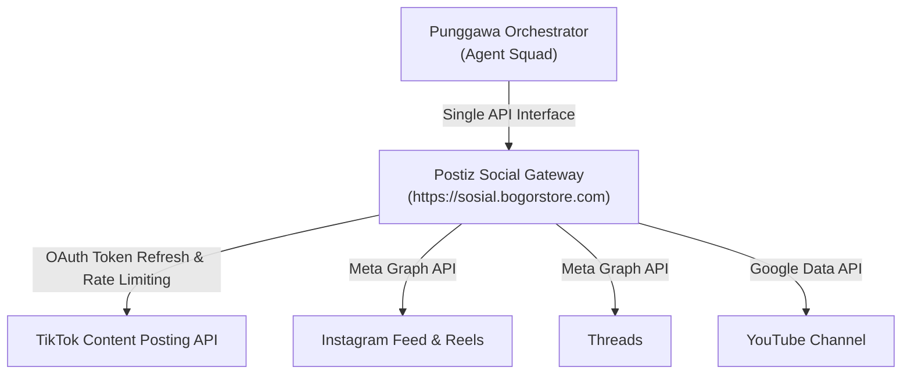

# Integrasi Postiz Social Gateway (Unified Social Bridge)

Dokumentasi lengkap mengenai **Postiz Social Gateway** sebagai jembatan terpusat publikasi media sosial multi-channel pada ekosistem **Punggawa**.

---

## 📑 Daftar Isi
1. [Ikhtisar & Keunggulan Arsitektur](#1-ikhtisar--keunggulan-arsitektur)
2. [Konfigurasi & Autentikasi](#2-konfigurasi--autentikasi)
3. [Daftar Integrasi Aktif Punggawa](#3-daftar-integrasi-aktif-punggawa)
4. [Endpoint Inti Postiz Public API](#4-endpoint-inti-postiz-public-api)
   - [Mendapatkan Daftar Channel (`GET /integrations`)](#mendapatkan-daftar-channel-get-integrations)
   - [Mengunggah Media File (`POST /upload`)](#mengunggah-media-file-post-upload)
   - [Menerbitkan Postingan (`POST /posts`)](#menerbitkan-postingan-post-posts)
   - [Mengecek Status Postingan (`GET /posts`)](#mengecek-status-postingan-get-posts)
5. [Contoh Payload Multi-Channel Broadcast](#5-contoh-payload-multi-channel-broadcast)
6. [Maintenance & Re-Autentikasi Akun](#6-maintenance--re-autentikasi-akun)
7. [Pengaturan Callback & Redirect URI di Portal Pengembang](#7-pengaturan-callback--redirect-uri-di-portal-pengembang)

---

## 1. Ikhtisar & Keunggulan Arsitektur

Postiz (`sosial.bogorstore.com`) bertindak sebagai **Social Gateway Abstraction Layer** bagi seluruh agen AI Punggawa (khususnya **Kang Sosmed**).



### Mengapa Punggawa Menggunakan Postiz?
1. **Single Point of Authentication**: Agen Punggawa tidak perlu menyimpan lusinan access token atau mengurus refresh token OAuth tiap 60 hari. Semua token dikelola secara aman oleh Postiz.
2. **Unified Media Storage**: Upload aset gambar dan video hanya perlu dilakukan satu kali ke Postiz Storage, lalu URL media tersebut dapat dibagikan ke seluruh platform tujuan.
3. **Standarisasi Payload**: API yang seragam untuk berbagai platform media sosial yang memiliki skema request berbeda-beda.
4. **Dashboard Monitoring**: Admin dapat melihat riwayat publikasi, jadwal kalender, dan status postingan langsung melalui antarmuka web Postiz.

---

## 2. Konfigurasi & Autentikasi

Semua request dari Punggawa ke Postiz wajib menyertakan API Key dalam header HTTP:

```env
POSTIZ_API_KEY=your_secret_api_key_here
POSTIZ_BASE_URL=https://sosial.bogorstore.com/api/public/v1
```

### Cara Mendapatkan API Key:
1. Login ke dashboard `https://sosial.bogorstore.com`.
2. Klik menu **Settings** (ikon gear di pojok kiri bawah) -> **API Keys**.
3. Klik **+ Generate New API Key**.
4. Salin kunci yang dihasilkan dan masukkan ke file `.env` sistem Punggawa.

---

## 3. Daftar Integrasi Aktif Punggawa

Tabel ID integrasi yang saat ini aktif digunakan dalam sistem:

| Platform | Nama Akun / Handle | Integration ID | Environment Variable |
|---|---|---|---|
| **TikTok** | DongengIDN (`@berdongeng`) | `cmw3byats000ao2745rk4z14k` | `POSTIZ_TIKTOK_INTEGRATION_ID` |
| **TikTok** | Kedai Daily Nurul (`@nurulzulaikhha`) | `cmw2y48yi0003o274ue9csad3` | `POSTIZ_TIKTOK_KEDAI_INTEGRATION_ID` |
| **Instagram** | Regi (`@reggimuhamad`) | `cmvvzqhn7000epl6yd8bp7mzz` | `POSTIZ_INSTAGRAM_INTEGRATION_ID` |
| **Threads** | Regi (`@reggimuhamad`) | `cmw1m3jvh0001o274j5o6snns` | `POSTIZ_THREADS_INTEGRATION_ID` |
| **YouTube** | Dongeng Nusantara | `cmw1jqlvs0001mk736aotawcm` | `POSTIZ_YOUTUBE_INTEGRATION_ID` |

---

## 4. Endpoint Inti Postiz Public API

### Mendapatkan Daftar Channel (`GET /integrations`)
Digunakan untuk melihat seluruh akun media sosial yang telah terhubung dan mengambil ID integrasinya:
```bash
curl -X GET "https://sosial.bogorstore.com/api/public/v1/integrations" \
  -H "Authorization: $POSTIZ_API_KEY"
```

### Mengunggah Media File (`POST /upload`)
Mendukung format gambar (`image/jpeg`, `image/png`, `image/webp`) dan video (`video/mp4`):
```bash
curl -X POST "https://sosial.bogorstore.com/api/public/v1/upload" \
  -H "Authorization: $POSTIZ_API_KEY" \
  -F "file=@konten.mp4;type=video/mp4"
```
**Respons Sukses (HTTP 201):**
```json
{
  "id": "cmw_media_uuid_7890",
  "path": "https://storage.bogorstore.com/uploads/konten.mp4"
}
```

### Menerbitkan Postingan (`POST /posts`)
Menerbitkan postingan secara instan (`type: "now"`) atau terjadwal (`type: "schedule"`):
```json
POST https://sosial.bogorstore.com/api/public/v1/posts
Header: Authorization: $POSTIZ_API_KEY
Content-Type: application/json

{
  "type": "now",
  "date": "2026-11-09T10:30:00.000Z",
  "shortLink": false,
  "tags": [],
  "posts": [
    {
      "integration": {
        "id": "cmvvzqhn7000epl6yd8bp7mzz"
      },
      "value": [
        {
          "content": "Caption postingan di sini...",
          "image": [
            {
              "id": "cmw_media_uuid_7890",
              "path": "https://storage.bogorstore.com/uploads/konten.mp4"
            }
          ]
        }
      ],
      "settings": {
        "__type": "instagram",
        "post_type": "post"
      }
    }
  ]
}
```

### Mengecek Status Postingan (`GET /posts`)
Digunakan oleh agen **Kang Bos** untuk audit penyelesaian publikasi:
```bash
curl -X GET "https://sosial.bogorstore.com/api/public/v1/posts?limit=10" \
  -H "Authorization: $POSTIZ_API_KEY"
```

---

## 5. Contoh Payload Multi-Channel Broadcast

Dengan satu kali pemanggilan API, Punggawa dapat mempublikasikan konten yang sama ke Instagram dan Threads sekaligus:

```json
{
  "type": "now",
  "date": "2026-11-09T12:00:00.000Z",
  "shortLink": false,
  "tags": ["tech", "punggawa"],
  "posts": [
    {
      "integration": { "id": "cmvvzqhn7000epl6yd8bp7mzz" },
      "value": [
        {
          "content": "Pembaruan arsitektur sistem Punggawa AI 🚀\n#tech #automation",
          "image": [{ "id": "media_banner_id", "path": "https://.../banner.jpg" }]
        }
      ],
      "settings": { "__type": "instagram", "post_type": "post" }
    },
    {
      "integration": { "id": "cmw1m3jvh0001o274j5o6snns" },
      "value": [
        {
          "content": "Pembaruan arsitektur sistem Punggawa AI 🚀",
          "image": [{ "id": "media_banner_id", "path": "https://.../banner.jpg" }]
        }
      ],
      "settings": { "__type": "threads" }
    }
  ]
}
```

---

## 6. Maintenance & Re-Autentikasi Akun

Jika salah satu akun media sosial gagal menerbitkan postingan karena masalah sesi atau token kedaluwarsa:
1. Buka `https://sosial.bogorstore.com/` dan masuk ke menu **Integrations**.
2. Cari channel yang bermasalah (akan muncul tanda peringatan merah/kuning jika token invalid).
3. Klik tombol **Reconnect** (atau hapus lalu tambahkan kembali).
4. Selesaikan login OAuth di jendela pop-up.
5. Setelah terhubung kembali, worker Punggawa dapat langsung memproses antrean berikutnya tanpa perlu restart sistem.

---

## 7. Pengaturan Callback & Redirect URI di Portal Pengembang

Saat membuat aplikasi OAuth di masing-masing portal pengembang, daftarkan **Domain & Redirect URI (Callback)** berikut agar alur otorisasi berhasil kembali ke Postiz:

| Platform | Portal Pengembang | Form Pengaturan di Portal | Redirect URI / Callback URL |
|---|---|---|---|
| **TikTok** | [developers.tiktok.com](https://developers.tiktok.com/) | Products > Login Kit > Redirect domains | `https://sosial.bogorstore.com`<br>`https://sosial.bogorstore.com/api/auth/callback/tiktok` |
| **Instagram** | [developers.facebook.com](https://developers.facebook.com/) | Instagram Basic Display / Graph API > Valid OAuth Redirect URIs | `https://sosial.bogorstore.com/api/auth/callback/instagram` |
| **Threads** | [developers.facebook.com](https://developers.facebook.com/) | Threads API > Valid OAuth Redirect URIs | `https://sosial.bogorstore.com/api/auth/callback/threads` |
| **YouTube** | [console.cloud.google.com](https://console.cloud.google.com/) | APIs & Services > Credentials > OAuth 2.0 Client IDs > Authorized redirect URIs | `https://sosial.bogorstore.com/api/auth/callback/google` |

