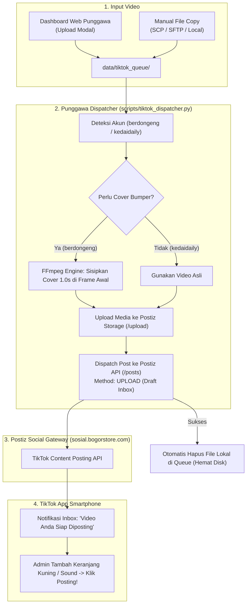

# Integrasi TikTok (Autonomous Queue & Draft Inbox)

Dokumentasi lengkap mengenai integrasi otomatisasi konten TikTok pada sistem **Punggawa**, mencakup konfigurasi OAuth, penanganan batasan Developer Sandbox, strategi multi-akun, penyisipan cover bumper via FFmpeg, upload gateway yang aman, serta manajemen antrean video.

---

## 📑 Daftar Isi
1. [Arsitektur & Alur Kerja](#1-arsitektur--alur-kerja)
2. [Konfigurasi Multi-Akun](#2-konfigurasi-multi-akun)
3. [Panduan Otorisasi OAuth & Sandbox Troubleshooting](#3-panduan-otorisasi-oauth--sandbox-troubleshooting)
   - [Mengatasi Error `non_sandbox_target`](#mengatasi-error-non_sandbox_target)
   - [Konfigurasi Scopes & Permissions](#konfigurasi-scopes--permissions)
   - [Pengajuan Mode Live / Production](#pengajuan-mode-live--production)
4. [Strategi Publikasi: Draf Inbox vs Direct Post](#4-strategi-publikasi-draf-inbox-vs-direct-post)
   - [Alur Penyematan Keranjang Kuning di HP](#alur-penyematan-keranjang-kuning-di-hp)
5. [Fitur Bumper Video Cover Otomatis (FFmpeg Engine)](#5-fitur-bumper-video-cover-otomatis-ffmpeg-engine)
   - [Mengapa Perlu Bumper Cover?](#mengapa-perlu-bumper-cover)
   - [Hierarki Resolusi Cover](#hierarki-resolusi-cover)
   - [Standar Format Video & Encoding](#standar-format-video--encoding)
6. [Struktur Folder Antrean & Format File](#6-struktur-folder-antrean--format-file)
7. [Web Upload Gateway di Dashboard Punggawa](#7-web-upload-gateway-di-dashboard-punggawa)
   - [Spesifikasi Keamanan Endpoint](#spesifikasi-keamanan-endpoint)
   - [Cara Upload via Dashboard Web](#cara-upload-via-dashboard-web)
8. [Rate Limit & Kebijakan Kuota TikTok](#8-rate-limit--kebijakan-kuota-tiktok)
9. [Panduan Pengoperasian CLI (`scripts/tiktok_dispatcher.py`)](#9-panduan-pengoperasian-cli-scriptstiktok_dispatcherpy)

---

## 1. Arsitektur & Alur Kerja

Punggawa mengintegrasikan TikTok melalui jembatan **Postiz Social Gateway API** yang terhubung langsung ke **TikTok Content Posting API**.



---

## 2. Konfigurasi Multi-Akun

Punggawa mengelola dua tipe akun TikTok dengan strategi yang berbeda:

| Akun Identifier | Nama Akun / Handle | Integration ID Postiz | Mode Posting | Auto Cover | Tujuan Utama |
|---|---|---|---|:---:|---|
| `berdongeng` | **DongengIDN** (`@berdongeng`) | `cmw3byats000ao2745rk4z14k` | `UPLOAD` (Draft Inbox) | ✅ (1.0s) | Konten edukasi anak, branding channel dongeng Indonesia. |
| `kedaidaily` | **Kedai Daily Nurul** (`@nurulzulaikhha`) | `cmw2y48yi0003o274ue9csad3` | `UPLOAD` (Draft Inbox) | ❌ | Penjualan produk & racun affiliate dengan Keranjang Kuning. |

Konfigurasi ini didefinisikan pada `scripts/tiktok_dispatcher.py` dan dapat disesuaikan melalui environment variables:
```env
POSTIZ_TIKTOK_INTEGRATION_ID=cmw3byats000ao2745rk4z14k
POSTIZ_TIKTOK_KEDAI_INTEGRATION_ID=cmw2y48yi0003o274ue9csad3
```

---

## 3. Panduan Otorisasi OAuth & Sandbox Troubleshooting

### Mengatasi Error `non_sandbox_target`

#### 📌 Penyebab Error
Error ini muncul saat Anda mencoba menghubungkan akun TikTok baru ke platform Postiz (`sosial.bogorstore.com`). Jika aplikasi di [TikTok Developer Portal](https://developers.tiktok.com/) masih berstatus **Sandbox (Development)**, TikTok secara ketat menolak login OAuth dari akun manapun yang **belum didaftarkan secara manual ke daftar Target Users**.

Pesan error yang muncul di browser:
```text
We couldn't log in with TikTok. This may be due to specific app settings.
If you're a developer, correct the following and try again:
non_sandbox_target
```

#### 🛠️ Langkah-Langkah Solusi (Menambahkan Target Users):
1. **Buka TikTok Developer Portal**:
   - Kunjungi [https://developers.tiktok.com/](https://developers.tiktok.com/) dan login menggunakan akun developer.
2. **Pilih Aplikasi Anda**:
   - Di menu navigasi atas, klik **My Apps** (atau **Manage apps**).
   - Pilih aplikasi integrasi sosial (misalnya: *Bogorstore Social* atau *Postiz*).
3. **Pastikan Mode Sandbox Aktif**:
   - Periksa toggle status di bagian atas layar, pastikan berada pada mode **Sandbox**.
4. **Masuk ke Sandbox Settings**:
   - Di bilah menu sebelah kiri, klik tab **Sandbox settings**.
5. **Tambahkan Akun TikTok (Target Users)**:
   - Gulir ke bagian **Target users**.
   - Klik tombol **+ Add account** (Anda dapat mendaftarkan hingga maksimal 10 akun penguji).
   - Akan muncul jendela otorisasi TikTok:
     - Masukkan Email, Nomor HP, atau Username TikTok yang ingin dihubungkan.
     - Masukkan password dan selesaikan verifikasi captcha.
     - Klik **Log in** dan setujui **TikTok Developer Terms of Service**.
6. **Verifikasi Status Akun**:
   - Akun yang berhasil diotorisasi akan langsung tercantum dalam tabel Target users dengan status aktif.
7. **Coba Hubungkan Ulang di Postiz**:
   - Buka kembali `https://sosial.bogorstore.com/integrations/social/tiktok`.
   - Klik **Connect / Tambah Akun TikTok**.
   - Login menggunakan akun yang baru saja didaftarkan. Otorisasi akan sukses tanpa pesan error `non_sandbox_target`.

---

### Konfigurasi Scopes & Permissions
Pastikan izin-izin berikut dicentang pada **Products > Login Kit & Video Kit** di Developer Portal:
- `user.info.basic`: Mengambil profil dasar dan username.
- `user.info.profile`: Avatar dan display name.
- `user.info.stats`: Statistik pengikut (opsional).
- `video.list`: Menampilkan status video.
- `video.upload`: Mengunggah file video ke server TikTok.
- `video.publish`: Mempublikasikan video atau mengirim draf ke inbox.

### Pengajuan Mode Live / Production
Jika aplikasi ingin dapat dihubungkan oleh akun TikTok publik tanpa perlu mendaftarkan akun satu per satu ke Target Users:
1. Lengkapi informasi aplikasi (Terms of Service URL, Privacy Policy URL, App Icon).
2. Rekam video screencast singkat yang memperlihatkan alur login OAuth dan fungsi posting.
3. Klik tombol **Submit for Review**. Setelah disetujui (*Approved*), ubah status aplikasi dari **Sandbox** ke **Live**.

---

## 4. Strategi Publikasi: Draf Inbox vs Direct Post

Punggawa mendukung dua mode publikasi melalui parameter `content_posting_method`:

| Parameter | Mode | Karakteristik | Rekomendasi Penggunaan |
|---|---|---|---|
| `UPLOAD` | **Draft Inbox (Direkomendasikan)** | Video dikirim ke Inbox aplikasi TikTok di smartphone admin sebagai Draf. | **Akun Jualan & Kreator**. Sangat ideal untuk menempelkan Keranjang Kuning, memilih audio trending, dan memaksimalkan FYP. |
| `DIRECT_POST` | **Direct Publish** | Video langsung dipublikasikan secara publik ke profil TikTok tanpa intervensi. | **Akun Berita / Arsip Otomatis** yang tidak memerlukan Keranjang Kuning atau pengeditan sound. |

### Mengapa Menggunakan Draf Inbox?
1. **Penempelan Keranjang Kuning TikTok Shop**: API resmi pihak ketiga TikTok melarang penempelan link produk keranjang kuning secara direct bot tanpa lisensi TikTok Shop Partner khusus. Dengan mode Draf Inbox, admin cukup menyematkannya dalam 2 ketukan di smartphone.
2. **Kepatuhan Audio & Lisensi Komersial**: Akun bisnis seringkali terkena mute otomatis jika video menggunakan lagu komersial via bot. Di Inbox, admin dapat memilih lagu populer yang sedang viral langsung dari katalog TikTok.
3. **Peningkatan Algoritma FYP**: Aktivitas interaksi admin saat memeriksa draf dan menekan publish memberikan sinyal positif bagi algoritma rekomendasi TikTok.

### Alur Penyematan Keranjang Kuning di HP
1. Worker Punggawa mengirim video -> Muncul push notification di HP admin: *"Video Anda siap diposting"*.
2. Buka aplikasi TikTok -> Masuk ke tab **Inbox** -> tap notifikasi sistem dari TikTok Creator Studio.
3. Tap **+ Tambah Tautan / Add Link** -> Pilih **Produk**.
4. Pilih produk yang relevan dari etalase toko afiliasi Anda.
5. Tap **Posting**. Video langsung live lengkap dengan Keranjang Kuning!

---

## 5. Fitur Bumper Video Cover Otomatis (FFmpeg Engine)

### Mengapa Perlu Bumper Cover?
Content Posting API TikTok **tidak menyediakan endpoint untuk mengunggah gambar cover kustom secara terpisah** (seperti halnya YouTube Thumbnail). TikTok hanya mengizinkan pemilihan frame cover berdasarkan durasi (`video_cover_timestamp_ms`).

Untuk memastikan video akun `@berdongeng` selalu menampilkan cover branding resmi di galeri TikTok, Punggawa mengembangkan **FFmpeg Bumper Engine**:
1. Menempelkan gambar cover resmi selama **1.0 detik** tepat di frame pertama video.
2. Mengubah rasio gambar menjadi vertikal standar **1080x1920 (9:16)** dengan padding proporsional.
3. Menghasilkan audio hening (*silent audio stream*) selama 1.0 detik agar sinkron dengan audio asli video.
4. Saat diposting, frame 0 detik langsung menjadi cover default yang indah di profil TikTok.

### Hierarki Resolusi Cover
Engine `scripts/tiktok_dispatcher.py` mencari gambar cover dengan urutan prioritas berikut:
1. **Per-Video Override**: `data/tiktok_queue/{subfolder}/{nama_video}.jpg` (atau `.png`, `_cover.jpg`).
2. **Per-Channel Integration ID**: `data/covers/{integration_id}.jpg` (misal: `data/covers/cmw3byats000ao2745rk4z14k.jpg`).
3. **Fallback Alias Channel**: `data/covers/berdongeng.jpg` atau `data/covers/dongeng.jpg`.

### Standar Format Video & Encoding
- **Resolusi**: 1080 x 1920 px (Portrait 9:16)
- **Video Codec**: `libx264`, preset `veryfast`, `crf 22`
- **Audio Codec**: `AAC`, 128 kbps stereo
- **Container**: MP4 dengan flag `+faststart` (streaming-ready)

---

## 6. Struktur Folder Antrean & Format File

Antrean file video disimpan di folder `data/tiktok_queue/` yang terbagi berdasarkan akun:

```text
data/
├── covers/
│   ├── cmw3byats000ao2745rk4z14k.jpg   # Cover resmi channel DongengIDN
│   └── berdongeng.jpg                  # Cover alias cadangan
│
└── tiktok_queue/
    ├── berdongeng/                     # Antrean akun DongengIDN (@berdongeng)
    │   ├── kancil_cerdik_01.mp4        # File video MP4
    │   └── kancil_cerdik_01.txt        # (Opsional) Caption kustom
    │
    └── kedaidaily/                     # Antrean akun Kedai Daily Nurul (@nurulzulaikhha)
        ├── gamis_premium_01.mp4
        └── gamis_premium_01.txt
```

> [!NOTE]
> **Pembersihan Otomatis (Auto Cleanup)**:
> Setelah video berhasil dikirimkan ke Postiz Storage dan diterima oleh TikTok Inbox, worker Punggawa **secara otomatis menghapus file `.mp4` dan file `.txt` terkait** dari folder antrean lokal. Hal ini menjamin kapasitas storage server tetap hemat dan terhindar dari pengiriman ganda.

---

## 7. Web Upload Gateway di Dashboard Punggawa

Untuk memudahkan admin mengunggah video langsung dari browser HP atau laptop tanpa perlu akses SSH/SFTP, Punggawa menyediakan antarmuka upload bawaan di Dashboard Web.

### Spesifikasi Keamanan Endpoint
Endpoint backend FastAPI berada di `server/stream_server.py`:
- `POST /api/tiktok/upload`
- `GET /api/tiktok/queue`

Fitur pengamanan yang diimplementasikan:
1. **Autentikasi Terenkripsi**: Wajib menyertakan header `Authorization: Bearer <ADMIN_PASSWORD>` atau token HMAC secret.
2. **Verifikasi Magic Bytes**: Memeriksa header biner file untuk memastikan file benar-benar berformat MP4 (`ftyp` signature), bukan file executable atau malware yang di-rename.
3. **Proteksi Path Traversal**: Nama file disanitasi menggunakan `os.path.basename` dan hanya boleh masuk ke subfolder akun yang valid (`berdongeng` atau `kedaidaily`).
4. **Batas Ukuran File**: Dibatasi maksimal **250 MB** per file video.

### Cara Upload via Dashboard Web
1. Buka Dashboard Punggawa di browser (misal: `http://localhost:8000` atau URL domain VPS Anda).
2. Masukkan Admin Password untuk membuka akses.
3. Di bilah menu atas atau HUD Controls, klik tombol **📱 Upload TikTok**.
4. Pilih **Target Akun**:
   - `DongengIDN (@berdongeng)`
   - `Kedai Daily Nurul (@nurulzulaikhha)`
5. Pilih file video MP4 dari galeri smartphone atau disk laptop Anda.
6. Masukkan caption kustom (opsional) atau gunakan template bawaan.
7. Klik **Upload ke Antrean TikTok**. Video akan langsung masuk ke folder antrean server dan siap diproses oleh dispatcher!

---

## 8. Rate Limit & Kebijakan Kuota TikTok

TikTok memberlakukan batas keamanan (*rate limit*) untuk menjaga integritas ekosistem:
- **Batas Draf Inbox**: Maksimal **5 video pending draf** di inbox dalam jendela waktu 24 jam per akun.
- **Pesan Batasan**: Jika batas ini terlampaui, TikTok akan menolak pengiriman dengan status error kuota.
- **Strategi Penanganan Punggawa**:
  - Dispatcher akan mencatat log peringatan kuota harian.
  - Video yang belum terkirim **tidak akan dihapus** dari folder antrean lokal.
  - Saat admin mempublikasikan draf di HP atau jendela 24 jam berganti, dispatcher pada siklus berikutnya akan melanjutkan pengiriman sisa antrean secara otomatis.

---

## 9. Panduan Pengoperasian CLI (`scripts/tiktok_dispatcher.py`)

Anda dapat menjalankan dispatcher secara manual melalui command line untuk keperluan testing, migrasi massal, atau cron job.

### 1. Dry Run (Simulasi Tanpa Mengirim)
```bash
./venv/bin/python scripts/tiktok_dispatcher.py --dry-run
```

### 2. Memproses 1 Video untuk Akun Berdongeng
```bash
./venv/bin/python scripts/tiktok_dispatcher.py --account berdongeng --limit 1
```

### 3. Memproses 1 Video untuk Akun Kedai Daily
```bash
./venv/bin/python scripts/tiktok_dispatcher.py --account kedaidaily --limit 1
```

### 4. Memproses Semua Antrean Video
```bash
./venv/bin/python scripts/tiktok_dispatcher.py --limit 10
```

### 5. Mengirim File Spesifik Secara Langsung
```bash
./venv/bin/python scripts/tiktok_dispatcher.py \
  --file /path/to/video.mp4 \
  --account berdongeng \
  --caption "Kisah kancil dan buaya yang cerdik 🦊✨ #dongengindonesia #fyp"
```

### Daftar Argumen CLI Lengkap
| Argumen | Default | Deskripsi |
|---|---|---|
| `--account` | Semua | Pilih akun target (`berdongeng` atau `kedaidaily`). |
| `--limit` | `1` | Jumlah maksimal video yang diproses per akun dalam satu kali run. |
| `--file` | None | Jalankan langsung pada satu file video tertentu. |
| `--caption` | Default | Menimpa caption video. |
| `--title` | Default | Judul video untuk metadata TikTok Studio. |
| `--method` | `UPLOAD` | Mode posting (`UPLOAD` untuk Draf Inbox, `DIRECT_POST` untuk langsung terbit). |
| `--no-cover` | False | Matikan penyisipan cover bumper otomatis. |
| `--cover-duration` | `1.0` | Durasi cover bumper dalam satuan detik. |
| `--dry-run` | False | Hanya simulasi alur tanpa mengunggah ke Postiz atau TikTok. |
