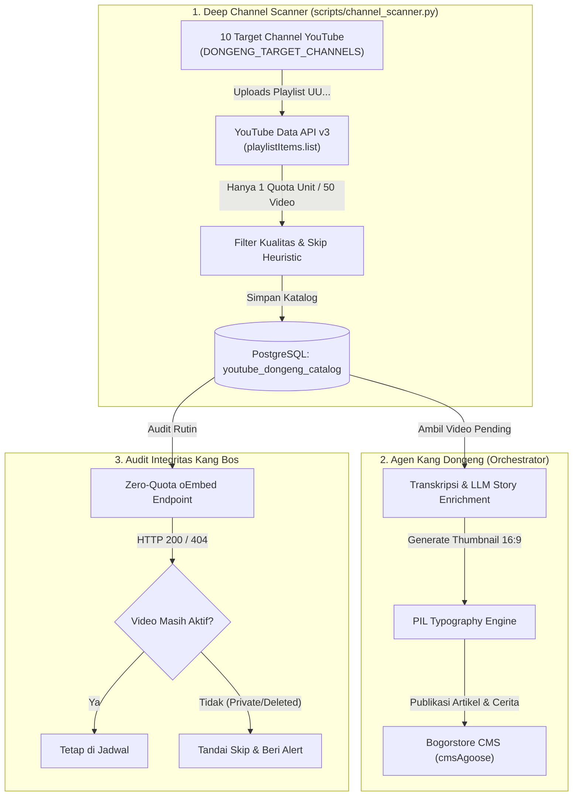

# Integrasi YouTube (Data API v3 & Channel Scanner)

Dokumentasi lengkap mengenai integrasi YouTube pada sistem **Punggawa**, meliputi kurasi otomatis channel dongeng anak, pemindaian katalog video dengan efisiensi kuota tingkat tinggi, verifikasi ketersediaan video tanpa kuota (*Zero-Quota oEmbed*), serta sindikasi ke Postiz dan CMS.

---

## 📑 Daftar Isi
1. [Arsitektur & Komponen](#1-arsitektur--komponen)
2. [Konfigurasi Environment](#2-konfigurasi-environment)
3. [Portal Developer, Domain & Pendaftaran Akun Tester (Google Cloud)](#3-portal-developer-domain--pendaftaran-akun-tester-google-cloud)
4. [Deep Channel Scanner (`scripts/channel_scanner.py`)](#4-deep-channel-scanner-scriptschannel_scannerpy)
   - [Strategi Uploads Playlist (Hemat Kuota 100x Lipat)](#strategi-uploads-playlist-hemat-kuota-100x-lipat)
   - [Penyaringan Kualitas & Filter Skip](#penyaringan-kualitas--filter-skip)
   - [Skema Database Katalog Video](#skema-database-katalog-video)
5. [Pemeriksaan Integritas Video Tanpa Kuota (Zero-Quota oEmbed)](#5-pemeriksaan-integritas-video-tanpa-kuota-zero-quota-oembed)
6. [YouTube Shorts & Stories Pipeline](#6-youtube-shorts--stories-pipeline)
7. [Publikasi YouTube via Postiz Gateway](#7-publikasi-youtube-via-postiz-gateway)
8. [Panduan Pengoperasian CLI](#8-panduan-pengoperasian-cli)

---

## 1. Arsitektur & Komponen

Dalam ekosistem Punggawa, agen **Kang Dongeng** dan **Kang Sosmed** berkolaborasi memproses konten YouTube:



---

## 2. Konfigurasi Environment

Variabel lingkungan yang mengatur koneksi YouTube di `config/settings.py` / `.env`:

```env
# YouTube Data API v3 Key
YOUTUBE_API_KEY=AIzaSyD_your_youtube_api_key_here

# Channel Target Kurasi Dongeng Anak (Format ID Channel UC...)
DONGENG_TARGET_CHANNELS=["UCxxxxxxxxxx1", "UCxxxxxxxxxx2"]

# Integrasi Postiz untuk Channel YouTube Sendiri (Dongeng Nusantara)
POSTIZ_YOUTUBE_INTEGRATION_ID=cmw1jqlvs0001mk736aotawcm
```

---

## 3. Portal Developer, Domain & Pendaftaran Akun Tester (Google Cloud)

Jika Anda menghubungkan channel YouTube Anda sendiri ke Postiz via Google OAuth 2.0 saat aplikasi Google Cloud masih berstatus **Testing (Uji Coba)**, Google hanya mengizinkan akun email yang secara eksplisit didaftarkan pada daftar **Test Users (Pengguna Uji)**.

### 🌐 Daftar Domain & URL Kunci
- **Google Cloud Console**: [https://console.cloud.google.com/](https://console.cloud.google.com/)
- **Halaman OAuth Consent Screen (Layar Persetujuan)**: [https://console.cloud.google.com/apis/credentials/consent](https://console.cloud.google.com/apis/credentials/consent)
- **Domain Redirect URI (OAuth Callback)**: `https://sosial.bogorstore.com/api/auth/callback/google`

---

### 🛠️ Langkah-Langkah Mendaftarkan Akun Tester di Google Cloud Console:

1. **Masuk ke Google Cloud Console**:
   - Buka [https://console.cloud.google.com/](https://console.cloud.google.com/) dan login menggunakan akun Google admin / pemilik project.
   - Pilih project Google Cloud yang Anda gunakan untuk integrasi YouTube/Postiz di bilah atas (*Project Selector*).

2. **Buka Menu OAuth Consent Screen**:
   - Pada panel navigasi kiri, pilih **APIs & Services** -> **OAuth consent screen** (Layar Persetujuan OAuth).
   - Pastikan **Publishing status** tertulis **Testing** (jika belum berstatus *In Production*).

3. **Tambahkan Email Tester (Test Users)**:
   - Gulir ke bawah hingga ke bagian **Test users (Pengguna uji)**.
   - Klik tombol **+ ADD USERS**.
   - Masukkan **Alamat Email Google / Gmail** dari akun yang ingin dihubungkan sebagai channel YouTube di Postiz (Anda dapat mendaftarkan hingga maksimal 100 email pengguna).
   - Klik **SAVE**.

4. **Hubungkan Channel YouTube di Postiz**:
   - Buka dashboard Postiz di `https://sosial.bogorstore.com/integrations`.
   - Klik **Connect YouTube**.
   - Pilih akun Google yang baru saja didaftarkan ke Test users.
   - Jika muncul peringatan *"Google hasn’t verified this app"*, klik **Advanced (Lanjutan)** -> lalu klik **Go to bogorstore.com (unsafe / lanjutkan)** -> centang seluruh izin YouTube dan klik **Continue**.
   - Channel YouTube akan langsung terhubung secara sukses tanpa terkena error `403: access_denied`.

---

## 4. Deep Channel Scanner (`scripts/channel_scanner.py`)

### Strategi Uploads Playlist (Hemat Kuota 100x Lipat)

YouTube Data API membatasi akun standar sebesar **10.000 quota units per hari**. 
- Metode pencarian standar (`search.list`) memakan biaya kuota sebesar **100 units per request**.
- **Solusi Inovatif Punggawa**: Punggawa memanfaatkan trik ID playlist unggahan channel (*Uploads Playlist*). 
  Setiap channel YouTube berformat ID `UC[suffix]` memiliki playlist unggahan lengkap dengan format `UU[suffix]`.

Dengan memanggil endpoint `playlistItems.list`:
- Biaya kuota: **Hanya 1 unit per request** (dapat menarik hingga 50 video sekaligus).
- Efisiensi: **100x lebih hemat kuota** dibandingkan metode pencarian biasa.

### Penyaringan Kualitas & Filter Skip
Punggawa secara otomatis mengabaikan video yang tidak memenuhi kriteria dongeng berkualitas (`looks_like_skip`):
- Video live stream berdurasi lebih dari 3 jam (misal siaran kompilasi non-stop).
- Video kompilasi lagu anak berulang tanpa narasi cerita.
- Video Shorts berdurasi di bawah 60 detik (dialihkan ke alur terpisah).
- Video yang sudah pernah diproses sebelumnya di tabel `content_schedules` atau `youtube_dongeng_catalog`.

### Skema Database Katalog Video
Data video yang lolos kurasi disimpan di tabel PostgreSQL:
```sql
CREATE TABLE IF NOT EXISTS youtube_dongeng_catalog (
    video_id VARCHAR(64) PRIMARY KEY,
    channel_id VARCHAR(64) NOT NULL,
    channel_title VARCHAR(255),
    title TEXT NOT NULL,
    description TEXT,
    published_at TIMESTAMPTZ,
    thumbnail_url TEXT,
    duration_seconds INT,
    status VARCHAR(32) DEFAULT 'pending', -- pending, scheduled, completed, skipped
    created_at TIMESTAMPTZ DEFAULT NOW()
);
```

---

## 5. Pemeriksaan Integritas Video Tanpa Kuota (Zero-Quota oEmbed)

Dalam jadwal publikasi harian, agen **Kang Bos** wajib memverifikasi bahwa video YouTube yang dijadwalkan masih berstatus publik (belum dihapus oleh pemilik aslinya atau diubah menjadi *Private*).

Jika menggunakan API v3 (`videos.list`), verifikasi ratusan video akan menghabiskan kuota harian. Punggawa menggunakan endpoint publik **YouTube oEmbed**:

```python
import httpx

def verify_youtube_video_availability(video_id: str) -> bool:
    """Verifikasi video publik tanpa memakan kuota YouTube Data API."""
    url = f"https://www.youtube.com/oembed?url=https://www.youtube.com/watch?v={video_id}&format=json"
    try:
        res = httpx.get(url, timeout=5.0)
        # HTTP 200 = Video aktif & publik
        # HTTP 404 / 401 = Video dihapus, di-private, atau region-restricted
        return res.status_code == 200
    except Exception:
        return False
```

---

## 6. YouTube Shorts & Stories Pipeline

Konten dongeng vertikal pendek (durasi < 60 detik) dideteksi dan disalurkan ke pipeline khusus:
1. **CMS Stories**: Dikirim ke endpoint `DONGENG_CMS_STORIES_URL` (`https://bogorstore.com/agoose/api/posts/stories`) agar tampil di fitur cerita instan aplikasi mobile.
2. **TikTok Cross-Post**: Dialirkan ke antrean `data/tiktok_queue/berdongeng/` untuk dipublikasikan ke akun TikTok `@berdongeng`.

---

## 7. Publikasi YouTube via Postiz Gateway

Untuk mempublikasikan video ke channel YouTube milik sendiri (*Dongeng Nusantara*), Punggawa menggunakan integrasi Postiz:
```json
{
  "type": "now",
  "posts": [
    {
      "integration": {
        "id": "cmw1jqlvs0001mk736aotawcm"
      },
      "value": [
        {
          "content": "Kisah Dongeng Nusantara: Timun Mas dan Raksasa\n\nSimak kisah selengkapnya...",
          "image": [
            {
              "id": "media_uuid",
              "path": "https://storage.bogorstore.com/uploads/timun_mas.mp4"
            }
          ]
        }
      ],
      "settings": {
        "__type": "youtube",
        "title": "Timun Mas dan Raksasa | Cerita Rakyat Indonesia",
        "privacy": "public"
      }
    }
  ]
}
```

---

## 8. Panduan Pengoperasian CLI

### 1. Menjalankan Pemindaian Seluruh Channel Target
```bash
./venv/bin/python scripts/channel_scanner.py
```

### 2. Menguji Pipeline Video Shorts / Stories
```bash
./venv/bin/python scripts/test_dongeng_shorts.py
```
